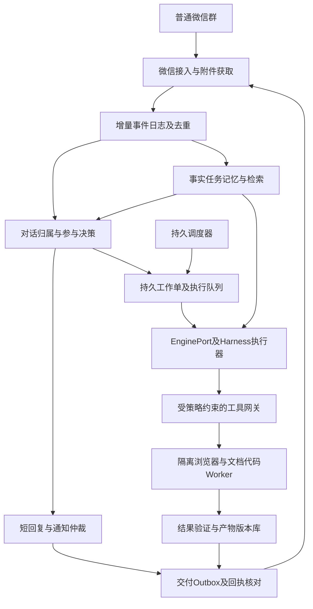

# 群聊通用智能体开发前评估报告

日期：2026年11月13日

状态：pre-spec 研究报告 v0.1；供产品范围与架构决策使用，尚未冻结实现规格。

范围更新：2026年11月13日，用户明确将视频识别移出当前开发计划。当前执行范围与默认行为以[Spec v0.1 Draft](SPEC_V0.1.zh-CN.md)为准；本文保留研究依据，不代表新版已实现。

## 一 结论与建议

**需求整体可行，但它对应的是一套群聊协作智能体系统，而非给现有机器人增加几条命令。建议新建工程，以成熟 Agent 执行框架承接工具循环，自建群聊参与、权限、任务、记忆、产物与交付层。**

优先路线是 **独立控制层＋DeepSeek Harness SDK／插件组合＋隔离执行环境＋微信适配器**。先验证关键能力，再确定是否需要少量修改上游代码。暂不建议深度改造 Harness 桌面产品，也不建议在旧版单文件业务逻辑上继续堆叠通用能力。

五项必须先确定的判断：

1. **群聊自然参与是一项独立能力。** 去掉“/组长”判断只能让机器人对所有消息响应，不能让它知道何时应该发言、正在回答谁、哪句话是在授权执行。
2. **任务的完成标准应是可验证的结果。** 声称做完、生成了文件、平台接受了发送、成员成功收到，是不同状态。
3. **普通微信群接入是最大外部依赖。** 当前通道可作为候选适配器；媒体、文件、重连、撤回与发送回执需要重新验收，不能直接沿用文本测试结论。
4. **DeepSeek Harness 值得复用，但必须控制版本、权限和数据流。** 当前开发预览存在破坏性变更；其最小 SDK 配置并非生产群聊的安全默认配置。
5. **现有2核2GB服务器适合保留接入服务或轻量验证，不宜未经压测承载完整浏览器、Office渲染、OCR和并发任务。** 新架构应允许把执行工作放到独立 worker。

本轮明确保留和调整的产品原则：无需特殊指令参与讨论；认识群成员的稳定微信ID；以群昵称为姓名来源，人工确认的例外单独保存；明确且低风险的请求不做机械二次确认；取消200字硬上限，日常回复简短，复杂交付通过正文、摘要或文件自然展开。

### 证据范围

本报告区分三类内容：**已核实事实**来自当前本地代码或公开一手资料；**建议**是拟采用的设计；**待验证**必须通过实验才能写成保证。旧服务器配置采用11月10日部署记录，本轮未重新登录生产服务器，也未读取真实群聊或私密附件。

已检查旧代码并重跑36项离线测试，全部通过。这说明原有测试覆盖的行为仍可运行，不证明新需求已经具备，也不代表生产可用率、文件保真度或 Agent 任务成功率。

## 二 现有原型为什么遇到上限

| 现状证据 | 对新需求的影响 | 处置建议 |
| --- | --- | --- |
| leader.py 的 extract_command 要求“/组长”；bridge.py 的 normalize_text 只接受 type=1文本 | 无法自然参与，也没有图片、文件消息链路 | 重做消息归一化和参与决策；文本适配经验保留 |
| natural.py 把输入分类为 answer/create/claim/report/complete/name | 只能执行预先定义的业务操作，没有连续工具调用与结果检查 | 用 Agent runtime 执行开放任务，业务操作改为受约束工具 |
| leader.py 的 MAX_REPLY 与 bridge.py 的发送端分别截断200字符 | 长回答与交付说明会被截断，生成内容与发送内容可能不同 | 新版移除硬截断，改为响应长度策略、分段与文件交付 |
| bridge.py 以同步子进程获取消息，模型、摘要、收发、提醒在同一轮处理中执行 | 长任务可能阻塞新消息、取消指令和提醒 | 接入进程只收发事件，执行进程独立排队 |
| messages 从固定 since 时间反复分页，每轮最多100页、每页100条 | 历史越长扫描越重；累计超过边界可能无法继续处理 | 使用持久增量游标，明确重连补拉和缺口修复 |
| memory.py 使用最近最多16条记录＋逐步摘要，完整原文留存 | 比纯无状态聊天更好，但缺少按主题、成员、任务和证据检索 | 保留原文与溯源，增加结构化事实和多路检索 |
| 日常跟进及到期提醒属于固定业务规则 | 不能自然创建、修改、暂停任意周期任务 | 建立持久 Schedule 对象与执行记录 |
| 有消息去重及不确定投递保护 | 这是有用基础，但一个不确定发送会暂停整个 bridge；没有通用产物交付状态机 | 改为逐项隔离、回执核对和可恢复 outbox |
| SQLite、成员ID、人工确认姓名和历史任务已经独立存储 | 可作为迁移数据，而不是丢掉重来 | 编写版本化迁移；不把讨论摘要当任务事实来源 |
| 旧目录未初始化 Git；生产曾通过手动上传、镜像标签和短期SSH维护 | 缺少可追溯版本、自动验收及可重复发布 | 新仓库、锁定依赖、CI、发布清单、迁移与回滚统一建立 |

还有一处重要隔离问题：当前 client 与 bot 挂载同一个 data 目录。对旧版受限分类器尚可管理，但扩展成可运行代码的 Agent 后，**执行 worker 不能继续看到微信凭证、全部客户端缓存和模型密钥**。应先拆开信任边界，再增加执行能力。

本地代码审计位置与哈希见 [来源登记](SOURCES.md)；本轮没有修改旧原型。

## 三 从参考产品中借鉴什么

### Grok Bot

官方文档描述了自然对话、工作期间追加指令、附件与结果展示，以及群中由 Bot 判断谁响应的交互。其群聊示例包含多个 Bot，并不等同于普通微信群中的多人协作，不能直接照搬权限和身份模型。[消息与协作](https://docs.x.ai/grok-bot/chat-and-collaboration)

主动性也有边界：发现机会、提出协助、提示需要关注的问题，与自行实施高风险操作分开。[主动参与](https://docs.x.ai/grok-bot/initiative)

建议借鉴：一个清楚的当前执行者、可中途改变方向的任务、把工具活动和产物当作工作过程的一部分，以及不让重复进度通知占满群聊。这里借鉴的是公开产品行为，不推断其内部模型架构。

### OpenAI Dots

Dots 的公开定位是持续在线、拥有云端计算机和浏览器、能在交谈之间继续推进责任的 Agent。它支持在工作期间接收新信息，参考已有记忆，并在需要判断时联系用户。[Meet dots](https://learn.chatgpt.com/docs/dots)

建议借鉴：**长期责任、对话和执行实例分离**。例如“维护课程项目进展”是责任，“本周补齐资料并生成展示稿”是一次工作，而群里的持续讨论是不断到来的上下文。不要为每条消息重新启动一个没有历史的助手，也不要让整个群的所有事情共享一个不可中断的长推理循环。

这不表示可以直接购买或调用“Dots 内核”接进微信群；本报告只把其公开交互与工作组织方式作为参考。

### DeepSeek Harness 与 Superagent 原型

Harness 是开源执行底座，核心强调插件组合。审阅时 master 指向 **39163dd30f703a79079e2d2446545cff3c453738**，根包版本 **0.2.2-rc.3**。这是研究基线，不是默认生产选版；源码构建要求与发布版安装要求需要分开看。[固定版本代码](https://github.com/deepseek-ai/deepseek-harness/tree/39163dd30f703a79079e2d2446545cff3c453738)

另一个值得参考的是 DeepSeek 团队公开的 **dsh-superagent-prototype**。它把来源事件、线程、评估、授权范围、工单和执行会话分开，适合启发群聊系统的控制层。但它自述是参考研究原型，主要面向单一 GitHub 仓库，可选接入飞书，不是可直接部署的通用微信群产品。[项目说明](https://github.com/deepseek-ai/dsh-superagent-prototype/blob/8c32a9dc5d72c033816c6a8110b37f40cf94fba4/README.md)、[领域模型](https://github.com/deepseek-ai/dsh-superagent-prototype/blob/8c32a9dc5d72c033816c6a8110b37f40cf94fba4/docs/001-domain.md)

值得移植的核心思想是：一个明确目标形成一个工作单；工作单拥有范围、上下文和执行记录；事件可以更新正在做的工作；任务有等待、失败、恢复和交付状态。工作目录和命令包装器本身不构成安全边界，这一点原型的执行文档也明确说明。[执行与恢复](https://github.com/deepseek-ai/dsh-superagent-prototype/blob/8c32a9dc5d72c033816c6a8110b37f40cf94fba4/docs/003-execution.md)

## 四 把需求转成可验收能力

以下优先级表示建设顺序，不表示删掉后续目标。P0为基础闭环，P1为完整日常协作，P2为更广的多模态与应用执行。

| 需求 | 建议能力定义 | 关键验收点 | 优先级 |
| --- | --- | --- | --- |
| 无特殊指令参与群聊 | 识别对自己的提问、可补充的信息、交付请求、玩笑与人际闲聊；允许主动提出低成本帮助 | 连续多人讨论不串人、不刷屏；自然语言暂停后立即安静 | P0 |
| 图片理解 | 下载消息对应的原图或可用图，绑定发送者、时间、引用关系，按需OCR与视觉推理 | 能回答截图、图表与作业照片；图片不可用时明确说明 | P0 |
| 多模态 | 当前目标包括文本、图片、语音；语音经ASR/TTS，视频识别按最新要求移出当前计划 | 分模态列样本与失败边界，不把“能看图”称作全部多模态完成 | 图片优先，语音随后；无视频开发任务 |
| 文件浏览与编辑 | 按文件ID搜索、读取、局部编辑、创建新版本、渲染预览、导出 | 覆盖.md/.docx/.pdf/.pptx；原件可追溯，重要格式不静默丢失 | P0/P1 |
| 联网搜索与整理 | 自主选查询、打开来源、核对日期与关键事实、形成有引用的结果 | 不拿搜索摘要冒充原文；断网、付费墙和来源冲突可诊断 | P0 |
| 自主任务执行 | 接受结果目标，分解、选工具、执行、验证、修复、交付 | 长任务期间仍可聊天、取消或改方向；不把计划当完成 | P0 |
| 文档、图片等交付 | 生成实际产物，检查内容及格式，发送文件或图片并记录回执 | 文件可打开、可下载、与请求一致；有产物ID与版本 | P0/P1 |
| 自主定时任务 | 从自然语言创建一次性或周期工作，修改、暂停、取消、解释下一次执行时间 | 重启后仍生效；时区、补跑、去重和费用上限明确 | P1 |
| 拟人化交流 | 理解指代、语气、插话时机及群内关系，日常短句，交付按需展开 | 不冒充真人经历，不滥发模板，不以截断文本实现“简洁” | P0 |
| 其他执行能力 | 受约束的代码运行、浏览器、数据处理、可扩展工具与技能目录 | 能力可发现、可测试、可停用；不是无限主机权限 | P1/P2 |
| 长期记忆和分工 | 保存事实、决策、任务、成员身份、偏好及其证据 | 讨论不自动变成承诺，改名不丢负责人，矛盾可更正 | P0 |

“完整功能”必须以能力目录、样本集、输入限制、降级方式和验收结果定义。无法合理承诺任意文件、任意网站、任意任务都100%自动完成。

## 五 推荐架构

建议采用**模块化单体控制层＋独立执行进程**，先把边界做清楚，不立即拆成大量微服务。

### 建议模块边界

| 模块 | 负责什么 | 不应负责什么 |
| --- | --- | --- |
| ChannelAdapter | 群白名单、身份、事件游标、附件、回执 | 调用任意模型或决定任务完成 |
| ConversationCoordinator | 消息属于哪个讨论或工作单、是否发言、何时合并回复 | 长时间运行Shell或渲染文件 |
| WorkService | 目标、权限范围、状态、预算、取消、重试 | 依赖某一家模型的私有会话格式 |
| AgentEngine | 推理—工具调用—观察—再执行循环 | 直接绕开工具网关发送群消息或获取账号凭证 |
| ToolGateway | 参数校验、身份与路径范围、成本、审计 | 把网页或文件内文字当成授权 |
| ArtifactService | 原件、派生版本、预览、验证结果、访问范围 | 直接覆盖唯一原文件 |
| MemoryService | 分层记忆、溯源、更正、检索和摘要 | 用摘要覆盖业务数据库中的负责人或完成状态 |
| Scheduler | 持久时间规则、执行实例、补跑与取消 | 仅依赖模型“记得明天再来” |
| DeliveryService | outbox、去重、平台回执、失败隔离 | 把超时当成功，或无条件重新发送 |

建议工作状态为：queued → running → waiting_input / waiting_external → validating → delivering → completed；另有 failed、cancelled、paused。停止整个 Agent、暂停一个任务和取消一个定时任务必须有不同语义。

会话维度至少分为群、讨论主题、工作单和成员；一个群不等于一个无限增长的推理会话。新消息能更新正在执行的工作，同时保留事件来源和版本；关联不确定时先澄清，不凭模型猜测把修改应用到另一个项目。

数据模型还应区分：**TeamTask是人类成员的分工，WorkOrder是交给Agent的结果目标，ExecutionAttempt是一次执行尝试，Schedule是何时唤起工作**。例如“我负责PPT”与“帮我制作PPT”不能都退化成一条待办；后者应产生执行工作，并可关联前者。Agent完成文件交付，也不必然表示成员已经完成课程最终提交。

### 工程技术路线建议

- 控制层优先 Python 3.11+，便于承接现有经验；通过 EnginePort 连接 DSH Python SDK／JSON-RPC运行时。
- 需要的原生 Harness 插件使用其 TypeScript/Cordis 机制；业务规则与数据模型不直接写入上游内部类。
- 文档、OCR和数据计算使用隔离的 Python worker；浏览器作为单独工具能力。
- 持久业务状态优先评估 PostgreSQL，产物使用文件／对象存储。早期单进程实验可用SQLite，但并发、迁移和恢复必须通过同一组契约测试。
- 先采用数据库工作队列与租约；只有吞吐量或部署拓扑确实需要时再增加Redis、独立向量库或复杂编排平台。
- 先单执行者＋按需独立验证，不默认给每个聊天回合启动多个子Agent。任务预算与并发配额由宿主统一执行。

开发助手当前能够使用的工具或产品插件，不会自动成为自建机器人的能力。每个外部工具都需要独立确认可用API、授权账号、部署方式、许可和计费；不能将闭源产品内部工具当作可直接复制的依赖。

以上是候选方案，最终依赖版本及进程拓扑由可行性实验决定。

## 六 DeepSeek Harness 采用策略

| 方案 | 优点 | 主要代价 | 结论 |
| --- | --- | --- | --- |
| 继续扩展旧分类器 | 最快增加一两个固定功能 | 任务循环、并发、恢复仍需从头设计 | 不作为新产品主路线 |
| Harness SDK＋插件组合 | 复用Agent循环、会话、工具生态和扩展点；可独立开发群聊层 | 需要核实接口、隔离和版本兼容 | **优先做POC** |
| 深度fork Harness桌面／Web应用 | 能改内部体验与服务 | 上游变更大、维护面广，群聊需求并不需要完整桌面产品 | 仅在明确阻塞时考虑 |
| LangGraph等自建编排 | 业务状态和持久化可控，框架可替换 | 更大比例的工具循环、媒体、执行与产物能力由团队承担 | EnginePort的备选路线 |

LangGraph 的公开文档提供了线程checkpoint与长期store的区分，适合作为恢复与记忆设计的备选参考；它同样不直接提供完整微信群产品。[Persistence](https://docs.langchain.com/oss/python/langgraph/persistence)

### 可以复用与不能误认为已经拥有的能力

Harness SDK服务提供会话、事件流、恢复及部分原生命令；普通图像输入可以进入附件机制。但通用.docx/.pptx上传、群身份、群内发言决策和可信文件交付仍是宿主应用的工作。[SDK服务说明](https://github.com/deepseek-ai/deepseek-harness/blob/39163dd30f703a79079e2d2446545cff3c453738/packages/sdk/server/README.md)

源码工作区要求 Node ≥24.9.0；发布的 Python SDK 文档要求 Python ≥3.10，并说明其匹配的运行时wheel正常执行无需系统Node。插件管理和源码构建另有依赖，不能把这两种安装方式混在一起估算部署成本。[package.json](https://github.com/deepseek-ai/deepseek-harness/blob/39163dd30f703a79079e2d2446545cff3c453738/package.json)、[Python SDK指南](https://github.com/deepseek-ai/deepseek-harness/blob/39163dd30f703a79079e2d2446545cff3c453738/docs/user/guide/python-sdk.md)

最小SDK配置需要特别处理：它省略部分Web、文本编辑、子Agent等能力，默认本地执行权限宽；官方指南还说明会话日志贡献插件默认随请求上传额外日志。建议建立自己的最小允许插件清单，显式关闭不需要的日志贡献，并用模拟接收端检查实际出站字段。**设置工作目录不等于限制文件访问范围。** 同一指南和 [SAFETY.md](https://github.com/deepseek-ai/deepseek-harness/blob/39163dd30f703a79079e2d2446545cff3c453738/SAFETY.md) 都是采用评审的必读项。

Harness具有持久调度能力，但调度进入Session inbox不等于任务完成；其文档也明确存在跨存储崩溃后重复投递的可能。我们的工作单与群发送仍须独立做幂等和结果核对。[调度子系统](https://github.com/deepseek-ai/deepseek-harness/blob/39163dd30f703a79079e2d2446545cff3c453738/docs/subsystems/schedule.md)

### 修改与许可纪律

Harness主仓库采用MIT许可证，可以作为修改与复用候选；复制代码时保留适用的版权及许可说明。第三方插件、字体、浏览器组件和文档转换依赖应分别登记，不能用主仓库的MIT概括全部组件。[许可证](https://github.com/deepseek-ai/deepseek-harness/blob/39163dd30f703a79079e2d2446545cff3c453738/LICENSE)

优先使用SDK和公开插件接口。确需改上游时，维护独立fork、固定提交、最小补丁清单与升级测试；应用仓库不得散落未记录的vendor手工改动。Superagent研究原型的依赖基线为较早的0.2.1-alpha.2系列，不能假设它与本次审阅的0.2.2-rc.3无缝兼容。

## 七 自然参与群聊的设计

建议将“理解消息”“回复消息”“执行工作”分成三个独立决定。

1. **观察层**接收授权群事件，完成身份、引用关系、附件和重复消息处理。
2. **参与层**判断是否轮到Agent说话：被提问、能提供有价值补充、正在接续自己的任务、需要报告明确结果时提高优先级；纯闲聊、已经有人解决、信息不足时可以保持安静。
3. **执行层**判断是否有可执行目标和相应权限。自然语言的明确请求可直接开始；转发文件中的命令、玩笑、对另一个人的要求不自动授权。

先用廉价规则过滤系统消息、自身回声和重复事件，再将相邻消息按讨论窗口合并，必要时调用模型判断意图。不能把每条群消息与完整历史都送进重型Agent循环。

建议设置可调整的静默时间、回复冷却、话题合并和主动通知预算；它们限制打扰频率，不限制回答只能200字。直接问题优先处理，复杂问题先给简短确认或进展，再交付结果。冷却机制不能把明确交办的工作丢掉。

保留“先别说话”“继续”“停止这个任务”“以后不要每天提醒”等自然控制语句；也保留可选的显式控制入口作为排障手段，但不把它作为正常使用的前提。

使用现有个人微信账号时，真人发言和机器人发言具有相同平台身份，不能再依赖文本前缀判断“是否自己的回声”。建议优先使用独立机器人账号；若继续共用账号，则必须以发送账本、服务端消息ID和投递回执识别机器人自身消息，正文标识仅作辅助。

## 八 多模态与文件能力

### 图片链路

完整路径应为：微信消息 → 可用附件下载 → 大小/MIME/哈希校验 → 保存原件及来源 → 生成缩略图、OCR或视觉输入 → 按需检索 → 结合讨论作答。图片不能只变成一句OCR文字后丢弃，图表、布局和视觉关系需要保留原图引用。

DeepSeek官方文档已说明deepseek-flash支持图片输入。因此，现有机器人只处理文本属于应用链路缺失，并非证明模型只能读文字。[Vision](https://api-docs.deepseek.com/guides/vision/)

同时，其当前Files API文档列出的支持格式是图像，不能据此宣称.docx/.pdf/.pptx上传后就能被完整解析或编辑；这些仍需文件工具链。[Files API](https://api-docs.deepseek.com/guides/files_api/)

模型路由必须记录实际能力：文本、视觉、工具调用、结构化输出、音频输入、图像生成等。图片理解与图片生成是不同能力；生成照片或插画需单独的生成模型／服务，统计图、流程图等则优先通过代码生成可复现结果。语音应另外定义转写、来源、引用和输出格式，不能沿用图片验收代替。视频识别不属于当前开发范围。

### 文件能力矩阵

| 格式 | 第一阶段承诺范围 | 编辑与验证办法 | 不应笼统承诺 |
| --- | --- | --- | --- |
| .md/.txt | 全文读取、检索、局部修改、生成 | 文本diff、链接与结构检查，保留版本 | 任意原始编码无损转换 |
| .docx | 段落、标题、表格、图片、常用样式；模板生成和定点修改 | python-docx或等价工具；渲染PDF/页面预览检查 | 所有修订、复杂嵌入对象和高级版式都能无损编辑 |
| .pdf | 文本与页面图像读取，页码引用，合并拆分、表单及标注；必要时重建输出 | 文本抽取＋按需OCR＋页面渲染；明确是否重新排版 | 任意PDF都能像Word一样修改且保持原版式 |
| .pptx | 幻灯片结构、文字、图片、表格与常用图表；模板生成和局部修改 | python-pptx或等价工具；逐页渲染检查溢出与遮挡 | 任意动画、插件和复杂对象均可修改 |

上述工具的公开能力可作为起点，但我们的验收责任仍包含文档内容和渲染结果。[python-docx](https://python-docx.readthedocs.io/en/latest/)、[python-pptx](https://python-pptx.readthedocs.io/en/latest/)、[LibreOffice命令行](https://help.libreoffice.org/latest/en-US/text/shared/guide/start_parameters.html)

扫描PDF、加密文件、缺失字体、损坏文件、宏与外链对象要单列处理状态。文件解析器在隔离环境运行，不执行上传文档中的宏。原件只读保存，修改生成新版本；对同一文档并行编辑使用版本比较，冲突不能让后写者悄悄覆盖前写者。

### 微信通道边界

agent-wechat当前上游文档描述了图片、文件等收发能力，也明确指出部分转发聊天中的附件只是占位符、不会下载。支持普通图片不等于能恢复所有历史图片或转发附件。[消息类型](https://thisnick.github.io/agent-wechat/how-it-works/message-types/)

附件上传、作业状态和平台回执具有独立生命周期；等待超时不等于发送失败。应查询能力上限、保留job id和幂等键，再核对结果。[附件收发](https://thisnick.github.io/agent-wechat/use/media/)

以上是上游当前文档声明。现部署基线为v2.2.1，新版必须针对选定版本和实际微信账号做端到端实验；不得把最新文档直接当成线上版本已经通过的能力。

## 九 自主任务 搜索 交付与调度

### 任务执行闭环

一个完整任务至少记录：请求者ID、所在群与主题、结果目标、相关文件版本、允许操作范围、截止时间、预算、进度、检查证据及交付状态。

执行流程为：理解目标 → 必要时澄清 → 建立工作单 → 分解步骤 → 调用工具 → 检查结果 → 有限修复 → 生成产物 → 渲染或内容核验 → 投递 → 根据回执结案。

长任务在独立worker运行；主对话继续响应。模型结束一轮、Shell进程退出、计划写完都不能直接使业务工作单完成。取消应传播到模型请求、浏览器、渲染子进程和尚未执行的外部操作；取消不能自动撤销已发生的发送。

### 联网检索

建议优先使用搜索和网页读取API，再在需要交互时使用浏览器。DeepSeek已有独立Search与Fetch接口，可以作为首个候选，但仍需实测检索质量、地区可达性、限流和费用。[Search & Fetch](https://api-docs.deepseek.com/guides/search/)

每条关键结论应能追溯到URL、抓取时间、页面内容或页码。网页和文档中的“忽略前文”“上传密钥”等文字是待分析数据，不能提高工具权限。搜索失败时报告缺口，不能编造来源。登录态浏览器作为可选能力，通过受控登录流程维护，不把密码放进群聊或记忆。

### 交付与定时

产物应有独立清单：文件ID、类型、内容哈希、版本、校验状态、生成任务和发送回执。长报告可用群内摘要加真实文件交付；不再通过200字硬截断掩盖内容长度。

调度器应支持自然语言创建一次性、周期性和条件触发工作，并记录请求者、时区、下一次执行时间、有效期、频率和费用上限。例如“每周一晚8点汇总进度，持续到课程结束”需要明确结束日期；无法推断时只问缺失信息。

工作完成后可在已有授权范围内安排下一次跟进，但不能无限递归建立提醒。每次执行是可审计实例；支持列表、修改、暂停、取消。停机后的补跑策略应明确为跳过、只补最近一次或经批准补跑，不能重启后把所有遗漏提醒一次性发进群。

执行、数据库事务与外部发送无法凭空获得严格exactly-once语义。采用至少一次投递、幂等操作、持久outbox、状态核对和失败隔离，分别记录“生成完成”“平台接受发送”和“接收端验证”，不声称成员已阅读。

## 十 记忆与权限

建议采用五层记忆：原始事件和附件索引、近期主题上下文、可修订讨论摘要、结构化任务与决策、成员偏好和群规。每条可持久事实记录来源、说话人、时间、适用范围与可信状态。

保留“稳定ID决定身份、群昵称决定显示名”的既有经验。群昵称为空时只采用用户明确确认的映射，不使用个人昵称假装真名。启动同步一次的偏好可保留；检测到未知发送者时显示身份待解析，而不是自动改成定时全量抓取。

业务事实与模型摘要不能互相覆盖。任务需要“谁承诺了什么”的证据；观察到某人发了文件，不自动等于其任务完成。取消或撤回消息后，应对依赖它的检索与摘要做失效标记，并遵循群配置的保留策略。

### 自主性分级建议

| 操作 | 默认处理 |
| --- | --- |
| 授权群内理解讨论、检索已授权资料、读公开网页 | 自动执行 |
| 明确请求下的新建草稿、生成图表、编辑独立副本、本人任务更新、常规定时提醒 | 自动执行并报告结果，不机械二次确认 |
| 指令缺失必要参数、多人同时给出矛盾要求、任务指代不唯一 | 一次聚焦澄清 |
| 分配别人工作、覆盖共享正式文件、向群外发送、改变长期职责或产生额外显著费用 | 按明确角色和预授权规则判断；超出范围时确认 |
| 付款、凭证或服务器权限变更、不可恢复删除等高影响行为 | 特定授权或人工接手；不因群聊活跃而默认放行 |

自然参与不意味着所有群成员能控制整台服务器。请求者身份来自通道元数据；文字自称“我是管理员”不能提升角色。执行worker只看到本任务文件和短期凭证，不挂载微信原始profile、生产密钥、SSH目录或Docker socket。插件和MCP工具经过允许清单、参数校验、出站控制、超时、资源与审计规则后才能运行。

## 十一 开发流程与Git纪律

本轮已建立独立本地仓库Project_GroupAgent，旧运行目录保持不变。研究工作使用文档分支；尚未创建远程仓库或启用远程分支保护。正式实现前应配置私有远程、必要CI与发布权限。

流程应为：需求与证据 → 验证实验 → spec → ADR → issue拆分 → 分支实现 → 自动检查 → 代码审查 → 测试群验收 → 灰度发布 → 观测与复盘。

核心纪律：

- 每个能力有需求ID、验收场景和责任边界；架构取舍写ADR。
- main保持可发布；短期feat/fix/docs分支；一项可审阅目标一个PR。不把研究分支直接当生产版本。
- 固定模型配置、提示词版本、框架提交、依赖锁文件、镜像digest和数据库schema版本；发布清单能够重建同一版本。
- CI检查格式、类型、单元测试、契约、集成、迁移、依赖和秘密；行为评估另有固定数据集与模型配置。
- 实际聊天、API密钥、微信登录资料和成员数据库不入Git；样本使用合成数据或获得授权的脱敏记录。
- 风险相关代码要经过第二轮审查。单人开发也要保留审查记录；Agent自评不能冒充独立人工批准。
- 生产不接受未提交的临时SSH热修；紧急修复必须补回仓库、测试与发布记录。
- 发版前备份并测试恢复；一个群同一时间只有一个生产发送者。数据库迁移失败不得自动继续启动新版本。

详细流程见 [ENGINEERING.md](ENGINEERING.md)。这些是拟实施的工程规则；不把文档中的CI和保护规则描述成当前已经配置。

## 十二 验证体系与上线门槛

以下数值是**建议的首版验收目标**，不是已有测量结果。最终阈值需在POC和试用数据上校准。

| 维度 | 建议验证集及门槛 |
| --- | --- |
| 自然参与 | 至少200个经标注的对话窗口，包含多个成员与并行话题；明确对Agent请求的识别召回率≥95%；不应介入窗口的误介入率≤5% |
| 任务执行 | 至少30项固定端到端任务，含搜索、附件、文档编辑、交付及失败恢复；无人工补救成功率目标≥85%，关键操作全部可追溯 |
| 身份与记忆 | 至少50组含改名、同名、撤回、矛盾更正和压缩的样例；任务负责人ID不串人；摘要不得修改事实库 |
| 文件质量 | 每种必选格式至少10个代表样例；格式可打开率100%；已声明支持的内容修改通过结构检查与渲染抽查 |
| 图片理解 | 至少30张作业照片、截图和图表；不可读图片不会被虚构成已理解；关键内容识别由人工标注评分 |
| 可靠性 | 网络断连、429、超时、进程被杀、发送结果不确定、任务取消、服务重启均有故障注入测试；不能产生已知可重放的重复外部操作 |
| 调度 | 时区、跨日、重启、取消、补跑、频率上限均有虚拟时钟测试；新建规则能解释下一次运行时间 |
| 安全隔离 | 合成恶意网页、附件、越权成员和路径逃逸测试中，禁止操作不执行；测试通过不等于已经完成全面安全审计 |
| 性能 | 首轮目标：服务收到事件后，短确认P95≤5秒、普通短回答P95≤20秒；微信传输延迟另计。长任务须能及时接收取消与新指令 |

先在独立测试群运行，初期使用shadow mode只记录“本会如何回复”，与人工判断比较；然后允许简短回复，再开放完整任务工具。不同阶段只开放已通过门槛的能力。

## 十三 部署资源与成本

已知旧环境为2vCPU、约2GiB内存、40GiB磁盘，Alibaba Cloud Linux 3，宿主glibc 2.32与Python 3.6；旧版已用容器解决运行时兼容。该配置来自既有部署证据，不是本轮新测量。

建议POC比较两种拓扑：轻量接入／控制服务与执行worker分开，或在一台较大实例上先分容器运行。**估算起点**为4vCPU、8GiB的单worker环境、同时一个重型任务；控制层可更小。是否需要升级、分机或按需worker，要用浏览器、Office渲染和图片批处理的峰值内存与耗时决定。本轮不购买或调整服务器。

主要成本不是“每条聊天多少钱”，而是路由、活跃对话、工具循环、摘要、图片、搜索、产物存储和计算资源的总和。

    日成本 = Σ各模型[(未缓存输入×输入单价 + 缓存输入×缓存单价 + 输出×输出单价) / 1,000,000]
             + 搜索/OCR/图片生成调用成本 + 执行环境 + 存储与流量

为说明量级而非报价，假设每天100次参与判断（各2000输入/100输出token）、40次活跃回复（各8000/300）、3个任务且每任务12轮（各12000/1500）、5次摘要（各20000/1000）：约105.2万输入、8.1万输出token／日，30天约3156万输入、243万输出token。缓存、视觉输入和模型路由会改变实际账单；这些请求量不是从真实群统计得出的。

实施时必须记录每个工作单的token、工具次数、运行时长、费用估计和失败重试，设置单任务、单群、单日预算。达到上限暂停并说明原因，而非无限自动重试。正式spec需要用户给出可接受的月度预算和服务目标。

## 十四 分阶段开发策略

时间仅为排期假设：一名有经验的工程负责人配合AI编码辅助、单群内测、接口可正常使用。完成可试用版本估计8—12周；质量稳定和能力扩展持续迭代。POC结束后重新估算，不能将此表视为交付承诺。

| 阶段 | 主要交付 | 退出条件 |
| --- | --- | --- |
| S0 需求与可行性，约1周 | 微信媒体往返、Harness SDK、权限隔离、文档渲染、状态恢复五组实验；补齐预算与角色 | 核心技术无阻塞；明确采用／替代路线与未解决问题 |
| S1 工程底座，约1—2周 | 远程仓库、CI、增量事件、ID体系、工作单、outbox、审计、配置与密钥隔离 | 可回放、可取消、可重启；不丢关键状态、不重复发送 |
| S2 首个完整闭环，约2—3周 | 自然交办→读群内图片或文件→搜索→生成.docx/.pdf→验证→发回群 | 真实测试群可从头到尾完成，不依赖人工搬文件 |
| S3 日常协作完整化，约2—3周 | 自然参与策略、长期记忆、.md/.docx/.pdf/.pptx读取和编辑、图片交付、持久调度 | 覆盖必选验收样例；日常对话简洁，产物质量可用 |
| S4 扩展多模态与执行，约1—2周 | 语音、浏览器复杂流程、按需多Agent、更多连接器；不包含视频 | 每项能力单独过验收，不用演示成功替代可靠性测试 |
| S5 试运行与发布，可与后期并行 | shadow回放、测试群灰度、故障演练、成本压测、升级回滚与运营看板 | 连续试运行达到约定SLO，运维与停止入口可用 |

优先交付一条真正闭合的工作流程，再扩宽工具目录。避免同时制作大量“看起来能调用”的工具，却没有任何一个复杂任务能稳定交付。

## 十五 进入spec前的必答问题

1. 是否继续使用真人微信账号，还是提供独立机器人账号？前者增加身份混淆和回声去重难度。
2. 哪些成员有权交办公共任务、给别人分工、修改群级规则或建立长期提醒？普通群主身份是否等于项目负责人，应明确配置。
3. 自动参与的期望强度、安静时段与可接受误插话率是什么？可以先用保守默认值shadow评估。
4. 第一批必须交付的十个真实任务是什么？例如资料综述、课程展示、PDF批注和每周进度报告，需提供经授权的代表样例。
5. 文档需要达到何种保真度？复杂模板、公式、图表、修订、动画是否属于首版必选项？
6. 群消息、图片和文件可保留多久、可发送给哪些模型供应商，删除时如何处理摘要、索引、备份和产物？
7. 现有服务器是否允许增加worker；可接受的月度费用、任务最长耗时和并发数是多少？
8. “自主交付”的允许范围是否仅限本群与工作区？群外发布、正式提交作业或连接其他账号需要单独定义。

这些问题影响授权、性能和范围，不宜靠提示词猜测。详见 [SPEC_READINESS.md](SPEC_READINESS.md)。

## 十六 本轮决策状态

**建议现在接受：**独立工程；取消200字硬截断；自然语言优先；业务状态与讨论记忆分离；有验证的文件交付；隔离执行；插件与依赖固定版本；用关键实验支撑spec。

**建议先试验：**DSH作为执行器的具体组合、微信媒体可靠性、文档工具保真度、自动参与阈值、执行资源与成本。

**尚未实施：**新版机器人功能、生产接入变更、远程Git仓库与CI、服务器扩容、模型或插件正式升级。本轮产物是报告、证据登记和工程流程草案，不是上线成果。

下一步应完成S0实验与上述决策，再编写可执行的产品spec、数据契约、工具契约和验收清单。
