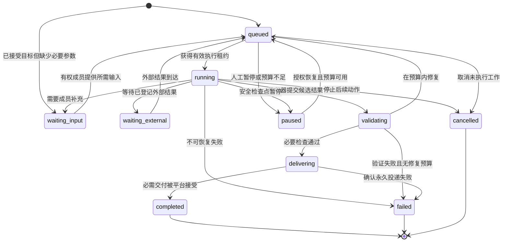

# GroupAgent v0.1 技术契约

状态：Draft，2026年11月13日。本文定义本项目内部契约，不表示第三方SDK已经提供同名接口。产品行为以[主规格](../SPEC_V0.1.zh-CN.md)为准；Harness具体版本与接口映射仍须经过E2验证。

## 1 部署单元与信任边界

1. **channel服务**：唯一持有微信登录资料的进程；只向控制层输出授权群事件、附件引用和发送回执。原始客户端可能维护额外账号缓存，但控制层和worker不能读取它。
2. **control服务**：参与决策、身份策略、TeamTask、WorkOrder、记忆检索、调度、outbox和审计。短交互不等待重型工作结束。
3. **engine进程**：实现EnginePort。每个工作有独立会话和工具范围；不得持有无范围限制的生产凭证。
4. **worker进程／容器**：浏览器、文档转换、OCR、代码和产物验证。只挂载本工作文件，设置CPU、内存、磁盘、网络、时间与进程数上限。
5. **业务存储与ArtifactStore**：持久状态使用PostgreSQL契约；文件按哈希及版本独立保存，不塞入模型会话日志。

首版允许control模块在一个服务内实现，不要求微服务网格。worker必须独立；channel凭证与worker不共享目录。生产不向公网开放数据库、内部工具网关或微信控制端口。

公共网页请求经受控fetch／浏览器工具：校验URL、重定向与解析后的地址，拒绝访问云元数据、私网或本机管理端点。业务内部API通过专门工具和身份凭证访问，不能通过通用网页抓取器绕过。

## 2 通用数据约定

- 全部ID以字符串传输，不能把平台长整数ID转为浮点数。
- 内部ID采用可唯一生成的UUID等方案；具体编码不作为业务含义。
- 时间保存为带时区的RFC3339 UTC时刻；用户本地时间规则另存IANA时区，默认Asia/Shanghai。
- 可修改资源包含revision正整数；修改请求携带expected_revision，冲突返回version_conflict。
- 客户端声明的角色、费用或“已完成”不是权威值，服务端根据配置、回执和验证记录计算。
- 所有持久业务记录按group_id或明确的工作域隔离；跨群访问默认拒绝。
- 原始文本、文件内容和外部工具结果标记为不可信数据；身份和授权来自受信通道及策略服务。

## 3 核心对象

| 对象 | 最少字段 | 不变量 |
| --- | --- | --- |
| Group | id、channel_account_id、external_group_id、policy_revision、mode、time_zone | 一个生产发送者；未授权群不入业务存储 |
| MemberIdentity | group_id、external_member_id、room_name、confirmed_name、name_source、membership_state | ID稳定；个人昵称不自动成为真名；unknown不等于已退群 |
| RoleBinding | group_id、member_id、role、granted_by、valid_until、revision | 不能由模型或聊天自称提升 |
| GroupEvent | id、source_key、group_id、actor_id、kind、occurred_at、received_at、reply_to、attachments、payload_ref | source_key唯一；原文可撤回失效但事件链不可被随意重写 |
| DiscussionThread | id、group_id、event_refs、participant_ids、linked_work_ids、revision | 关联必须有证据；一条消息可关联上下文但不必触发多次操作 |
| TeamTask | id、group_id、title、owner_id、due_at、status、progress、evidence_refs、revision | 负责人是ID；更新有角色检查；不由摘要直接改写 |
| WorkOrder | id、group_id、requester_id、goal、acceptance_criteria、input_versions、scope、budget、state、goal_revision | 是Agent结果目标，不是人类待办，也不是一次模型调用 |
| ExecutionAttempt | id、work_id、attempt_no、lease_owner、fencing_token、heartbeat_at、checkpoint_ref、state | 同一work最多一个有效主执行租约；重试不生成新的授权范围 |
| ToolInvocation | id、work_id、attempt_id、tool、input_hash、idempotency_key、policy_revision、effect_state、result_ref | 每次副作用可查，不能只靠模型文字判断成功 |
| ArtifactVersion | id、artifact_id、parent_version_id、group_id、work_id、mime、sha256、size、storage_ref、validation_state | 发布后不可原地修改；原件与新版本均可追溯 |
| Schedule | id、group_id、creator_id、scope、timing、time_zone、valid_until、next_due_at、misfire_policy、state、revision | 创建有权限和额度；时间规则可解释且持久化 |
| ScheduleOccurrence | id、schedule_id、scheduled_at、work_id、state | schedule_id＋scheduled_at唯一；重复唤醒关联同一次工作 |
| DeliveryIntent | id、group_id、work_id、payload_ref、payload_hash、idempotency_key、state | 同一交付目的不能因重试改用新幂等键 |
| DeliveryReceipt | intent_id、platform_message_id、platform_job_id、accepted_at、verification_state | 平台接受不等于用户已读 |
| Fact | id、group_id、subject_id、predicate、value、source_refs、validity、revision | 能更正、失效与溯源；不同成员的“我”不能合并 |
| MemorySummary | id、group_id、thread_id、source_range、summary_ref、version、incomplete | 是派生上下文，不能覆盖原始事实 |
| AuditEvent | id、trace_id、actor_id、policy_revision、action、resource_refs、outcome、time | 不保存秘密；足以重建谁依据什么规则做了什么 |

实际DDL、索引和迁移文件在S1实现。上述唯一性、授权与版本要求是约束，不可因使用不同ORM而省略。

## 4 事件契约与消息处理

### 4.1 统一事件

GroupEvent.kind至少包括text、image、audio、file、quote、forwarded、recall、membership、system和unsupported_video。不能因为不支持某个类型就把它当成空文本成功处理。

规范示例见 [event.example.json](examples/event.example.json)。其中source_key优先使用平台的稳定服务端ID加账号范围；如果只有本地ID，必须加source_epoch，并把换号／重登迁移的去重风险显式处理，不能假定同一个本地编号一直代表同一条消息。

### 4.2 增量消费

接入层先持久化事件和对应游标，再确认消费。处理层另有自己的状态，不能用“模型是否回答完”决定接入游标推进。

采用事件流或可持续的增量游标；保留有界回补窗口修复乱序与短暂掉线。去重依靠source_key，不依靠时间戳或消息文本。无法修复的缺口形成channel_gap记录与告警，不静默略过，也不无界扫描全部历史。

一次数据库事务内完成：事件幂等判定、业务状态变更、相应审计和必要outbox写入。实际模型请求、网络下载、工具执行和微信发送不得占用长数据库事务。

### 4.3 自身回声

用DeliveryReceipt中的平台消息ID和发送操作记录识别Bot消息；同账号真人从手机发出的消息不能一律忽略。纯文本“【机器人】”标识、相同内容、outgoing方向或近似时间均不足以单独证明来源。

在实际适配器上无法可靠区分来源时，共用账号模式不得通过E1验收；需要独立账号或降低自动执行范围，不能带着已知循环风险上线。

### 4.4 参与决定

Decision包含decision_id、input_event_ids、thread_id、policy_revision、kind、reason_code、target_work_id和必要的clarification。reason_code用于审计与评估，不向群里展示内部推理。

同一讨论窗口只允许一个有效评估者。策略或目标版本变化时，旧决定必须重新验证。start_work要经过工作准入；reply只能进入outbox，不能绕过发送策略。

简单的任务认领、查询或编辑也可以使用内部短WorkOrder承载工具授权、预算和审计，但不需要在群里为每个短操作发送接单播报。无工具的普通闲聊可直接reply；所有模型自主发起的工具调用必须属于某个已准入WorkOrder。

## 5 内部端口

每个端口的所有操作均携带服务身份／请求上下文、trace_id和必要幂等键。下表是项目契约，具体HTTP、RPC或函数实现由模块边界决定。

| 端口 | 必需操作 | 关键输出与限制 |
| --- | --- | --- |
| ChannelAdapter | capabilities、consume(after_cursor)、resolve_member、fetch_attachment、send(intent)、lookup_delivery(key) | 能力声明、来源、可用性、稳定ID与回执；禁止任意群发送 |
| ConversationCoordinator | accept_event、decide、route_followup、set_participation | 明确静默／回答／工作／控制决定；不能阻塞于长工具 |
| WorkService | create、get、revise、pause、resume、cancel、retry、list | 持久目标、权限、revision、状态与预算；重试不是重建目标 |
| EnginePort | start、append_input、cancel、resume、events、inspect | 统一的执行事件；只返回候选完成与产物，不直接结案 |
| ToolGateway | describe、authorize、invoke、inspect_effect、cancel | typed输入输出、权限、费用预留、幂等和effect_state |
| ArtifactService | list、read、search、create_version、validate、publish | artifact_id/version_id而非任意宿主路径；写入采用预期版本 |
| MemoryService | retrieve、record_fact、correct、compact、invalidate、forget_request | 来源范围、可信状态、缺口与删除状态 |
| Scheduler | create、get、list、update、pause、resume、cancel、run_now | 下一次执行、有效期、发生记录与revision冲突 |
| DeliveryService | enqueue、dispatch、reconcile、inspect、cancel_pending | outbox与平台回执；结果不明不得换键重发 |

### 5.1 EnginePort事件

执行器至少输出：run_started、input_consumed、tool_requested、tool_finished、artifact_candidate、progress、needs_input、checkpoint_saved、run_finished、run_failed、run_cancelled。

每个事件包含work_id、attempt_id、sequence、time和typed payload。必须有序号去重并可恢复读取。不得将第三方框架的原始会话文件直接当作业务主表。

run_finished仅表示执行器认为本轮完成。控制层仍要检查：目标revision是否最新、必需工具是否成功、产物是否验证、预算是否正常结束以及交付是否接受。因token或时间用尽结束的轮次必须转为暂停／失败或明确部分结果，不能伪装完成。

### 5.2 工具注册

ToolDefinition字段至少包括name、version、input_schema、output_schema、risk_class、required_roles、resource_scopes、timeout、max_output_bytes、cost_meter和idempotency_mode。

允许的idempotency_mode：read_only、native_key、managed_transaction、reconcile_before_retry、non_retryable。模型不得选择更宽松的模式，工具实现必须申明并通过测试。

Shell工具虽然可能运行很多程序，也必须受工作范围、预装软件、网络和资源约束。工具返回的附件与文件路径要再次经过范围检查，防止工具输出把工作区外资源“包装”为合法产物。

### 5.3 模型能力注册

模型路由保存provider、model_id、能力标志、上下文上限、价格快照、超时和版本记录。分别验证启用的text、vision、tool_call、structured_output和speech_to_text，禁止以供应商品牌推断能力。按用户最新范围，image_generation外部插画及text_to_speech不属于本轮必选路由；TTS已于2026年11月16日明确暂缓。

默认文本/工具路由与视觉路由可复用同一模型，ASR独立配置。`speech_reply_on_request=false`，`text_to_speech`样例值为`NOT_IN_CURRENT_SCOPE`，不要求TTS凭据、不向当前工具清单授予语音生成能力。image_generation和视频能力标志必须为false；当前工作授权不包含独立插画生成或视频解析工具。文字、附件与ASR输入继续使用原有权限、预算和交付契约；程序绘图通过隔离计算工具生成并校验真实图片产物。

## 6 WorkOrder状态机

图展示主路径；waiting_input、waiting_external、paused、validating和delivering也允许有权取消。所有非终态都允许请求暂停，已开始的外部副作用先登记并核对；暂停状态不能触发新工具。failed可在明确retry请求后创建新的ExecutionAttempt并转queued，completed若有新目标应创建关联的后续WorkOrder，而非篡改已经交付的历史。

实现允许的转换如下；表外转换拒绝并记录，模型不能直接任意设置state：

| 当前状态 | 可到达状态 | 附加条件 |
| --- | --- | --- |
| 新建 | queued、waiting_input | 目标与权限已准入；缺必要参数不能排入实际执行 |
| queued | running、waiting_input、paused、failed、cancelled | running需要有效租约；超期或不可恢复配置错误可failed |
| running | queued、waiting_input、waiting_external、validating、paused、failed、cancelled | 回queued只用于已登记的恢复／重试；副作用先核对 |
| waiting_input | queued、paused、failed、cancelled | 收到所需且有权的输入才回queued；不能被无关闲聊唤醒执行 |
| waiting_external | queued、paused、failed、cancelled | 外部结果或可重试失败已被登记后重新调度 |
| validating | queued、delivering、paused、failed、cancelled | 只有必要校验全部通过才delivering；修复受剩余预算约束 |
| delivering | completed、paused、failed、cancelled | completed要求必需交付accepted；unknown必须paused并核对 |
| paused | queued、failed、cancelled | 授权恢复、暂停原因消除且预算可用；从checkpoint决定后续阶段 |
| failed | queued | 只允许明确retry，产生新attempt，保留失败与副作用历史 |
| completed、cancelled | 无 | 后续新要求创建关联WorkOrder，不重写已结案记录 |

暂停原因包括user_request、budget_exhausted、policy_changed、delivery_uncertain和dependency_unavailable。对delivery_uncertain，只有核对结果或有权人工处置后才能恢复，不随意重试。

工作创建默认对应当前group与授权讨论。接受了某一请求后，要持久化request_event_id到work_id映射；同一请求重放不能创建第二项等效工作。

## 7 执行租约与故障恢复

- 一次有效主执行租约默认30秒，10秒心跳；具体worker耗时不能通过锁住数据库延长租约。
- 每次新租约分配单调递增fencing_token。旧worker的状态提交、产物发布和新副作用请求均须拒绝过期token。
- worker崩溃可恢复到最近的业务检查点，但不得假设运行中的Shell进程还在。先核对文件版本、工具效果和发送账本，再决定重试。
- 对408、429、网络超时和部分5xx采用有上限退避；默认最多2次额外尝试，遵循Retry-After，且计入原工作预算。
- 认证错误进入waiting_external或paused并通知有权维护者；参数错误返回clarification；不可恢复的格式或权限错误不做网络式重复重试。
- 对同一文件的编辑冲突以expected_version控制；不能由“谁最后完成模型请求”决定覆盖。

外部服务可能在本地超时后完成请求。fencing_token不能撤销它已经发生的行为，因此副作用幂等键必须独立于attempt_id，跨重试仍保持一致。

## 8 投递状态与幂等

DeliveryIntent状态：pending → dispatching → accepted；明确拒绝为rejected；无法确定为unknown。unknown只进入reconcile，不生成新intent或新幂等键。取消仅能阻止未提交的pending项；dispatching可能已经产生副作用。

建议幂等键由group、work、交付目的、逻辑输出revision及目标产物版本构成，而不是每次发送随机生成。修订后的新结果可创建新的交付revision，网络重试则必须沿用原revision和键。一次说明文字和多个附件可组成DeliveryBundle，每个部分有独立intent与固定顺序。单个附件失败不应让已经发送的其他部分全部重发。

通道有原生幂等与查询能力时优先使用；没有时需要保存可证明的发送标识并把不确定项隔离。不能仅以“最近群里有同样文字”断言发送完成。接收端人工验收与平台accepted分开记录。

## 9 调度契约

Schedule示例见 [schedule.example.json](examples/schedule.example.json)。其状态为active、paused、ended、cancelled；每个发生记录状态为pending、enqueued、running、succeeded、failed、skipped、uncertain。

定时到期先持久化ScheduleOccurrence和对应WorkOrder，再提交规则下一次时间；同一规则同一scheduled_at重复唤醒指向同一工作。任务“已经入队”不等于“执行成功”。

规则更新携带expected_revision。暂停/取消必须在派发及工具执行前复查；已经发出的消息无法用取消规则自动撤回。事件触发需要固定类型、资源范围、去重键、截止日与派生深度上限，不运行模型生成的任意监听代码。

默认重叠策略coalesce，错过执行latest_only。时钟回退不重复已承认的occurrence；时区变化只重算未来触发，不改写历史UTC时刻。一次性本地时间存在歧义时澄清；周期本地时间遇不存在时刻跳过，遇重复时刻只执行一次并记录所采用的时刻。

## 10 产物状态与存储

Attachment状态至少有discovered、downloading、available、expired、recalled、unsupported、failed。下载完成必须验证实际格式与大小；哈希用作内容标识，不能把平台MD5当成安全鉴定。

ArtifactVersion状态为staging、candidate、validated、published、quarantined、superseded。写入临时位置、校验哈希和版本后原子发布。未通过检查的candidate不能被当成正式完成产物发送；允许明确标记的预览草稿，但不得混淆其状态。

扫描PDF和复杂文档的验证分为结构、内容与渲染。检查器应产生ValidationResult：检查类型、输入版本、结果、问题位置、证据路径和工具版本。截图与中间文件使用内部artifact引用，不把执行主机绝对路径发给群成员。

## 11 记忆与删除契约

记忆检索在同一group、授权主题和工作文件范围内执行。每条检索结果包含source_refs、time、author_id、validity和retrieval_reason，模型不能把摘要的一句猜测当成已确认任务。

摘要推进游标与摘要版本同一事务提交；失败时保留原始可检索记录。压缩会遗漏细节，因此不能宣称“永远不会忘”。结构化任务、姓名映射和被明确保存的项目决策有独立生命周期。

forget_request先确定操作者权限、对象范围与删除策略；在线检索立即排除获准删除内容，并使相关摘要失效／重建。备份内的副本按保留期淘汰并记载，不能声称立即清空所有历史介质。长期业务事实在来源原文过期后保留最小证据标识，不保留没有必要的整段聊天。

## 12 错误与诊断

统一错误对象至少包含code、message、retryable、effect_state、trace_id和可选resource_ref。message是可呈现摘要，不含密钥或完整工具stderr。

| code | 默认处理 |
| --- | --- |
| invalid_input / ambiguous_reference | 聚焦澄清，不重复副作用 |
| permission_denied / scope_violation | 拒绝相关操作，记录审计 |
| unsupported_media / unsupported_video | 标记不可处理；按用户意图决定是否说明 |
| attachment_expired / recalled | 不读取缓存冒充有效内容，请求可用资料 |
| version_conflict | 展示冲突或重新基于最新版本规划 |
| budget_exhausted / quota_exceeded | 暂停，通知有权人；不自动增加预算 |
| provider_unavailable / rate_limited | 有上限退避，仍受取消和费用限制 |
| auth_required / channel_offline | 暂停相关动作并告警，不循环发送登录信息到全群 |
| delivery_unknown | 核对原幂等键与回执；不换键重发 |
| validation_failed | 有限修复，或交付明确失败／部分结果 |
| cancelled / stale_lease | 结束当前尝试，不再调用新工具 |

## 13 配置与运行控制

[config.example.json](config.example.json)只定义非秘密配置草案，密钥由独立存储或环境凭证引用提供。生产启动必须验证群白名单、owner绑定、日费用限额、模型能力、工具允许清单、数据保留策略及存储可写性。

配置变更有revision。角色或范围收紧对新动作立即生效；已有工作需要重新校验。暂停一个模型供应商或工具时，不能绕到更宽权限的替代实现；只能采用事先批准且通过同一契约的替代路由。

模型、工具、提示词、文件转换器和引擎版本写入每个工作轨迹。日志保留可观测元数据和经过处理的错误，不默认上传全部群会话到供应商的额外日志通道。

## 14 迁移与发布

旧SQLite数据迁移到新对象时，保留稳定成员ID、已确认姓名、原任务归属、状态和来源；旧Task映射为TeamTask，不凭空变成待执行WorkOrder。旧摘要仅作历史参考，并标记来源与可能缺口。

旧版隐含的每日跟进、截止提醒与去重状态应先列成迁移清单。由owner在切换前明确保留范围和有效期，再转换为可见规则；不得静默丢失，也不得擅自扩成无限期周期工作。

迁移需支持dry-run、记录数／哈希比较、重复运行幂等和失败退出。新profile本地消息编号变化时必须使用新的source_epoch，并明确迁移切换时刻。新旧发送器不能同时消费并回复同一生产群。

发版先验证独立环境，再shadow、测试群、小范围执行。保留旧数据和已验证的回滚方式；若schema不向后兼容，不允许仅换回镜像就假装回滚成功。

当前尚未冻结的底层方案只限：Harness具体运行组合、通道版本、模型及媒体供应商、worker资源规格。上述身份、范围、状态、幂等、取消、版本和审计语义不能因选型不同而省略。
